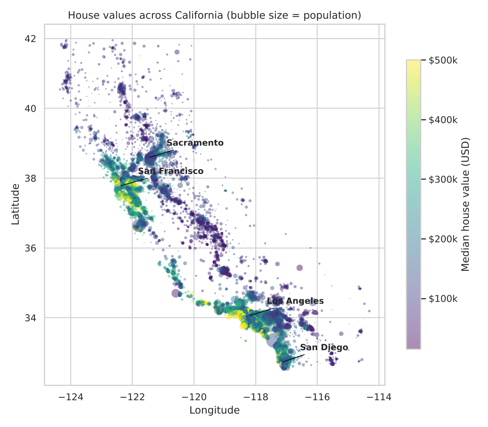
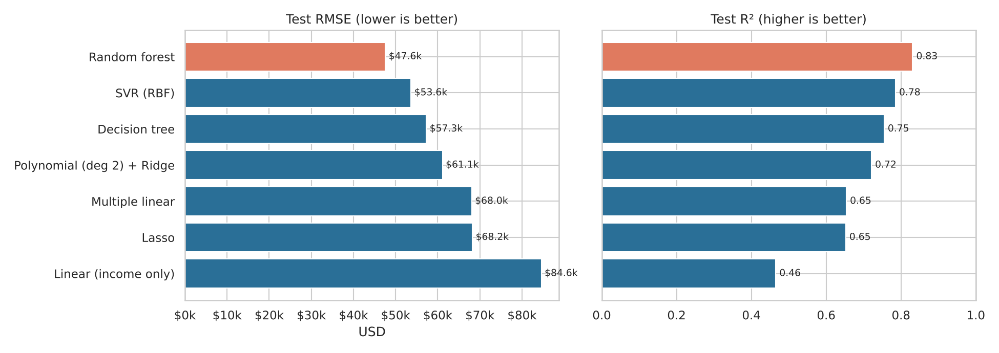
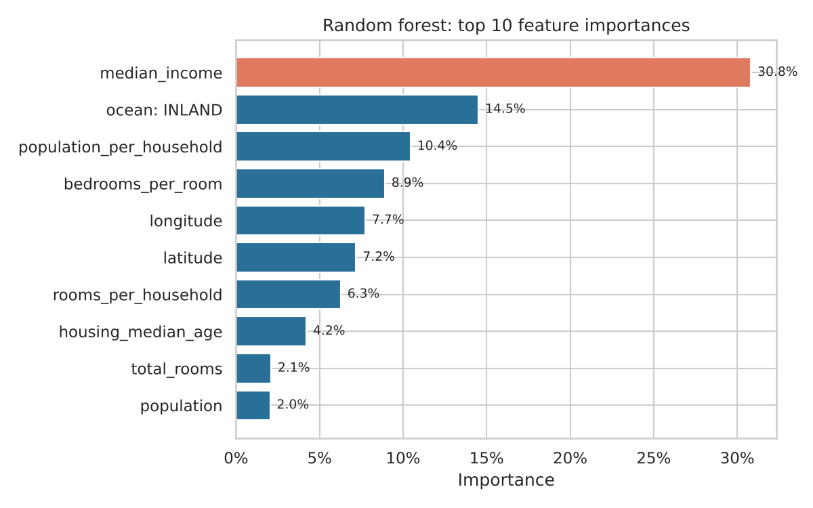
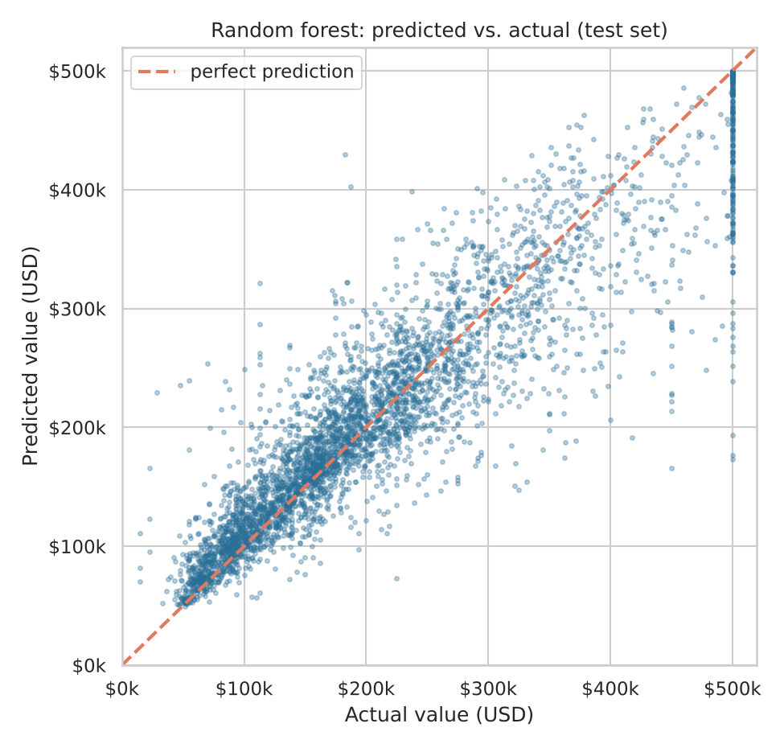
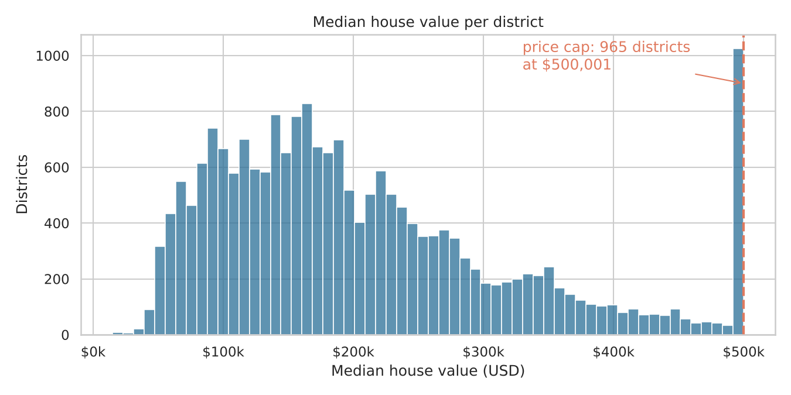
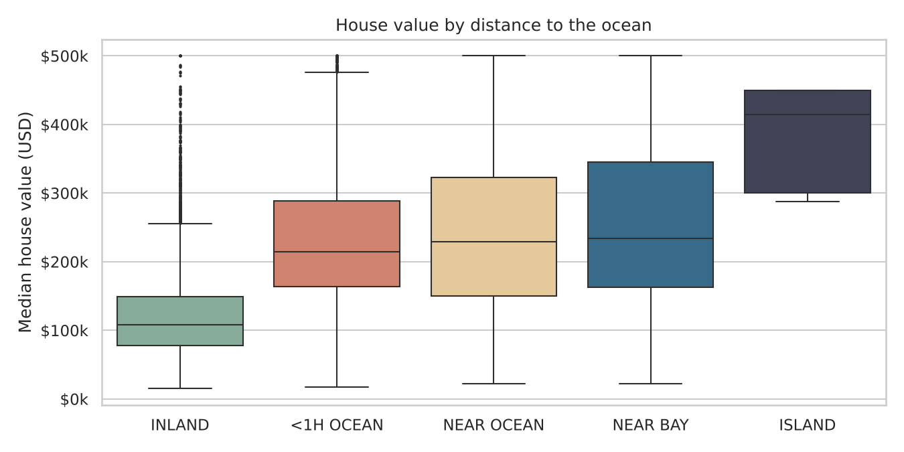
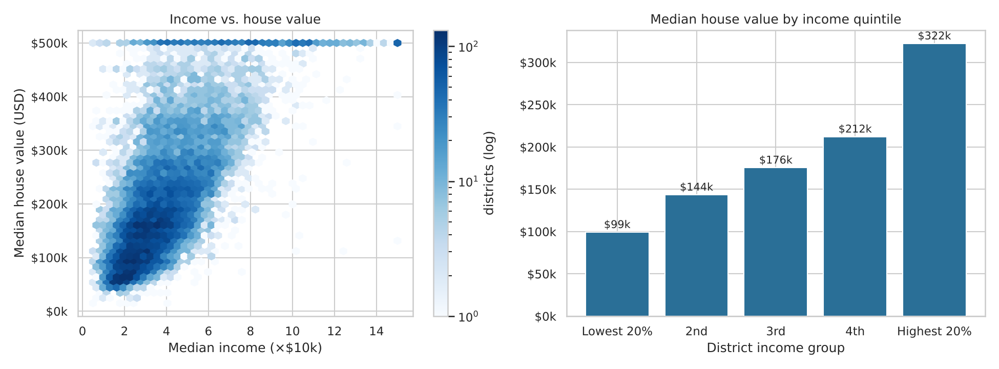
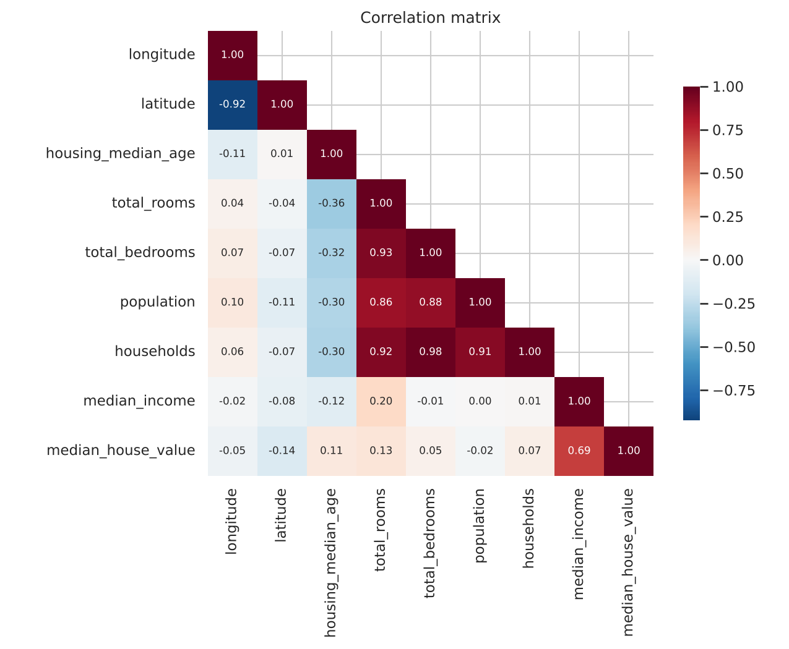

# California Housing — Exploratory Data Analysis & Price Prediction

What drives house prices in California, and how well can we predict them?
An end-to-end analysis of 20,640 census districts: data cleaning, exploratory analysis, feature engineering and a comparison of 7 regression models.

**Author:** Ajla Rašljanin · Master studies in Artificial Intelligence · Course: Decision Support Systems

<p align="center">
  
</p>

## Key findings

| # | Finding |
|---|---------|
| 1 | **Income is the #1 driver.** Median income correlates with price at r = 0.69; districts in the top income quintile are **3.2×** more expensive than those in the bottom quintile. |
| 2 | **Location is the second driver.** Coastal districts are **2.0×** more expensive than inland ones (median $219k vs $108k). Prices cluster around the San Francisco Bay Area, Los Angeles and San Diego. |
| 3 | **Ratio features beat raw counts.** `bedrooms_per_room` (r = −0.26) is far more informative than `total_bedrooms` (r = 0.05), because raw counts mostly measure district size. |
| 4 | **Random forest is the best model:** R² = **0.83**, typical error (MAE) **$31.8k**, RMSE 44% lower than an income-only linear baseline. Half of the districts are predicted within $20k. |
| 5 | **Data limitation:** 965 districts are capped at $500,001 by the census, so no model can value the most expensive areas correctly (errors there are 2× higher). |

## Model comparison (test set, 4,128 districts)

| Model | RMSE | MAE | R² |
|---|---:|---:|---:|
| **Random forest** | **$47,557** | **$31,766** | **0.831** |
| SVR (RBF kernel) | $53,633 | $35,077 | 0.785 |
| Decision tree | $57,275 | $38,657 | 0.755 |
| Polynomial (degree 2) + Ridge | $61,101 | $43,348 | 0.721 |
| Multiple linear regression | $68,041 | $49,024 | 0.654 |
| Lasso | $68,211 | $49,065 | 0.652 |
| Linear regression (income only) | $84,570 | $63,231 | 0.465 |



| What drives the prediction | How close the predictions are |
|---|---|
|  |  |

## Exploratory analysis

| | |
|---|---|
|  |  |
|  |  |

## Methodology

- **Data quality:** 207 missing `total_bedrooms` values (1%) imputed with the median; three top-coded columns identified (price, house age, income).
- **Split:** 80/20 train/test, stratified by income quintile.
- **Preprocessing pipeline** (scikit-learn `Pipeline` + `ColumnTransformer`): ratio features → median imputation → scaling (linear models, SVR) → one-hot encoding of `ocean_proximity`. All preprocessing is fitted on the training set only, so there is no data leakage.
- **Tuning:** hyperparameters selected by cross-validation on the training set (`GridSearchCV` / `RandomizedSearchCV`); the test set is used once for the final comparison.
- **Metrics:** RMSE and MAE in USD, R².

## Repository structure

| Path | Description |
|------|-------------|
| `analysis.ipynb` | Full analysis notebook with outputs |
| `data/housing.csv` | Dataset (20,640 rows) |
| `figures/` | All charts used in the notebook and this README |
| `requirements.txt` | Python dependencies |

## How to run

```bash
pip install -r requirements.txt
jupyter notebook analysis.ipynb
```

The full notebook runs in about 3 minutes on a laptop (most of it is the random forest and SVR tuning).

## Data source

California Housing dataset, 1990 U.S. Census. Pace, R. K. & Barry, R. (1997), *Sparse Spatial Autoregressions*, Statistics & Probability Letters 33, 291–297. Version with the `ocean_proximity` feature from A. Géron, *Hands-On Machine Learning with Scikit-Learn, Keras & TensorFlow*.

## Next steps

- Gradient boosting (XGBoost / LightGBM)
- Distance-to-nearest-city features
- Separate handling of capped districts (e.g. censored regression)
